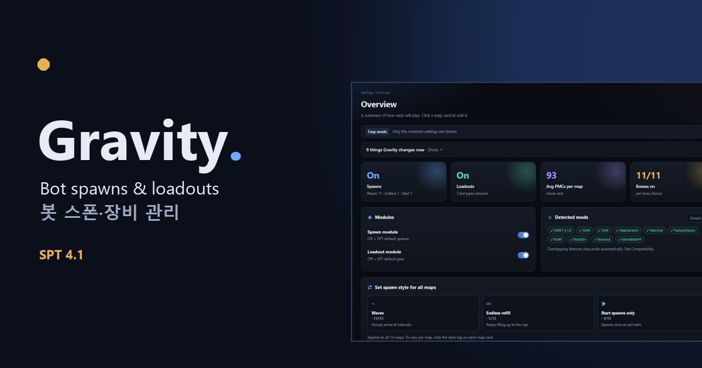

  
  

  

<h2 align="center">📖 <a href="https://danyhappy564-cmyk.github.io/Gravity/?lang=en">Everything is explained on the project site →</a></h2>

Spawns · bosses · loadout tiers · presets · other mods · install and notes, all on one page with screenshots of the web UI.

  
  

## Changelog

The full changelog (51 entries) is in the [`changelog/`](changelog/) folder, 10 per file (higher number = newer, latest: [`CHANGELOG-006.md`](changelog/CHANGELOG-006.md)). Per-release summaries: [Releases](../../releases).

# Gravity 1.1.4

If you like the mod, you can support it here: https://buymeacoffee.com/real_feels

A server + client mod for SPT **4.1**. It decides in one place **who spawns, when, where, and with what gear**. Everything is set from a web page you open in your browser while the game server is running.

## What it does

**Spawn module**

- PMCs: starting squads plus waves or continuous refills, squad-size mix, faction mix, difficulty and level range (optional: `Roll difficulty per member`, off by default — when off, the whole squad shares one difficulty), stop near the end of the raid.
- Scavs: starting count, active/quiet cycles, map caps (one shared value or per map), protection radius around the player for refills, **intensity over the raid** (early/mid/late multipliers, e.g. the reverse of PMCs: more scavs later).
- Bosses and special bots (sniper scavs, Raiders, Rogues, Cultists, …): chance, count and timing on a timeline; 0 means they never appear. Bosses can have a **chance per map** (empty = the boss's default/shared chance).
- Special bots can be added to maps that don't have them (e.g. Raiders or Rogues on Customs). Extra Raider/Rogue groups get a group count and early/mid/late weights.
- **Trigger spawns**: chance and size for groups released by levers, switches and exfils (Labs and Reserve Raiders) and by game events (Labyrinth Tagilla helpers, Kaban snipers). Raider lever groups can be switched to Rogues or Black Division (the trigger stays the same).
- Faction mods (RUAF, BlackDiv, …) and events (Halloween, Christmas, …): detected, each can be turned on or off.
- Per-map spawn zones, raid-wide group limits, SVM extra raid time detection, raid presets you can save and import.
- Each map shows an estimate of how many PMCs and scavs to expect.

**Loadout module**

- Bots get a tier T1–T7 from their level; each tier picks weapons, armor, plate classes, ammo, meds and attachments.
- **Item tiers**: items are ranked by price (flea, or handbook when missing) within the same slot or type and split into 7 tiers, with the reason shown. Click to override.
- **Per-bot item table** (Gear tiers › Per-bot item table tab): per tier, the items and their share, counts and chances, caps and plates, attachments, and a **Tier summary** tab showing what that tier actually carries.
- Attachments follow tiers too. If every part that fits a gun is above the tier, the lowest-tier one is used, so guns never come out bare (can be turned off in Weapon build).
- Mod items: on/off per installed mod, use only part of them each raid, PMC-only.
- **Clothing** (Mod items → Clothing tab): PMCs and scavs wear clothes only from checked mods (matching their side; chosen per mod). Until you save it once, bot outfits are left untouched.
- Loadout presets: **Gravity auto** and **Realistic Live-like 1.0.2** (see Credits) are built in; you can save your own.

## Install

1. Extract the archive into your SPT 4.1 folder. You should get `BepInEx\plugins\Gravity` and `SPT_Runtime\user\mods\Gravity`.
2. Start the server and open `https://127.0.0.1:6969/gravity/` in a browser (also listed on the SPT launcher's mod page).
3. Change settings and press **Save**; they apply from the next raid.

If you open the page from another PC or a Fika/LAN address (anything other than 127.0.0.1 on the server PC), log in with an SPT web admin account using the **SPT login** button at the top before saving — the same SPT login used by SAIN and other mod web pages. Opened on the server PC at 127.0.0.1, no login is needed.

Use **1.0.3 or later within the 1.0.x series** for both server and client. Mixing with 1.0.2 or older is unsupported. Starting scavs are prepared together at the configured delay: 0 min prepares them during loading; the default delay is 4 min. Starting PMC squads prepare their members during loading, with up to 60 seconds of additional waiting. Map capacity, group limits, or unavailable spawn points can leave some bots in the existing queue and delay activation.

**1.1.4:** The web settings are easier to use. It now opens on **Quick setup** (step buttons for bot count, raid flow, difficulty, gear level, boss frequency and performance), adds **Find a setting** at the top of the sidebar (`/` or Ctrl+K; advanced settings switch to Advanced mode and jump to the field), and trims the menu from 22 to 16 entries (Gear tiers, Presets & backup, Compatibility and In-game now use tabs; old links open the new place). Changing a shared value on a map tab now asks "this map only / all maps". Item tiers can filter ammo by **penetration band**. New **health multiplier per bot type** (Bot health & skills, applied after tier health) and a per-map **Leave this map’s scavs to vanilla** switch (for quest areas such as the Customs gas station that got too few scavs). PMC squads can roll difficulty per member (optional, off by default). Six new FAQ entries; setting names in FAQ answers jump to that field.

**1.1.2:** Near-player spawns never ran on a Fika headless host; they now take turns around the connected human players. Single-player is unchanged. Also fixed PMC generation on the server failing for the rest of a session (starting PMCs ending at 0 and `capacity` errors piling up in the server log). Each bot now filters its own copy of the consumable lists, so later high-tier PMCs no longer get med lists trimmed to an earlier bot's tier. Two same-faction PMC squads spawning into the same zone at about the same time no longer get merged by the game into one 5–6-man group; one wave is now one group, so squad-size settings and group limits match what spawns. Weapon build → Mags · ammo gets a loose-ammo "Base stack size" choice (EFT default / game value) and a "Stack size" % range. The default is the original EFT stack size, so mods such as SVM that enlarge ammo stacks no longer put hundreds of rounds in pockets. Server and client both changed; settings carry over.

**1.1.1:** Fewer bots stuck in bad spots or appearing right in front of you. At raid start, each spawn point is checked once against the map's real bot navigation. Points with no walkable ground nearby, points cut off from patrol routes, and points whose only way out is a crouch-height gap no longer get bots. The pit by the tanks in the middle of Factory, where bots got stuck crouching, is blocked outright. Scavs (including marksmen) now spawn first at points that are at least the scav distance from every player and out of sight. If there are none, half the distance is allowed, still out of sight. Next comes a point at the full scav distance even if it is in view. If there is still nothing, the spawn waits briefly and tries again. Timed scav waves from the server get the same check. Any 1.1.x server and client work together.

**1.1.0:** Fixed high-tier bot guns missing scopes (mount slots that take scopes now roll at least the scope chance; parts with no table in SPT bot data are filled from another bot table that has them). In a server test the PMC scope rate rose from about 80% to 91–94%. **Loose ammo** is now on by default (40% per bot, up to 2 stacks). Fresh installs use the web page defaults as shown. Settings that were on the web page but never reached the game (large-mag limit, scope/tactical caps, night flashlight, per-map weapon range, top-loaded rounds, boss progression, near-spawn delay, respawn caps, start squad rules and more) now all apply, and near spawns' **Allow spawning in sight** no longer works backwards. Newly applied options that would change the result of an older settings file are read as their previous behavior (loose ammo and the sight fix apply right away). Adds **BTR frequency** (Woods and Streets only), per-tab mod item switches, an on-screen display and Spawn now (Dev & testing). Works with **Fika hosts** (contributed by darkarchon) and **Customs Classic** (MapVariants 1.1.0+).

**1.0.9:** Fixed scav raids getting zero PMCs when PMCs are set to "start only". Added a **Time left** option to how PMC groups are kept in scav raids (keeps the share of raid time still left). New **Use mod items** switch: off on a fresh install, existing settings stay on. Mod weapons and gear can produce odd combinations, so tidy them in the Tier editor if you turn them on. Vanilla guns missing from a bot type's table now borrow the parts list of a bot table that has the gun (USEC/BEAR first) for more natural builds, and the bot gear log shows scope and part count.

**1.0.8:** Adds **Scav lean** to the scav card (wave lean = refill frequency, size lean = live scav cap), **Wave PMC locations** to the placement card (PMC points / Whole map: only wave PMCs, evenly across scav zones too, no sniper spots), and **Total bots per raid** to the limits card (a running total; when reached only Gravity's own spawns stop). Squads no longer pick a point another squad is still loading at, and PMC followers more than 30 s behind their leader are dropped when the leader is dead or the spot is right next to a person. The raid report gains **Squad diagnostics** (overlaps, late followers, start PMCs planned/activated) and the end-of-raid log gets a one-line start PMC result. New options give the same result as 1.0.7 at their defaults.

**1.0.7:** Fixed the timeline special-bot lanes (Sniper scavs, Cultists, Bloodhounds, etc.): once a lane was expanded there was nothing to click to open its settings, so the chance could not be changed (since 1.0.6). Clicking the summary text on the right or the time bubble now opens the settings; dragging the bubble still only moves the time. Only the server and web changed; spawn results are the same as 1.0.6.

**1.0.6:** Raiders, Rogues, Cultists and Bloodhounds can be added to maps that don’t have them (the Special bots page marks "Original / Added by Gravity"). Labs/Reserve lever and exfil groups and Labyrinth/Streets event groups get their own chance and size, and Raider lever groups can be switched to Rogues or Black Division. Extra Raider/Rogue groups: 1–6 groups with early/mid/late weights. Scavs get early/mid/late intensity, so they can ramp up late in the raid (starting scavs excluded, map cap respected). Lever groups also get a delay after the trigger and a "share as the swapped group" (e.g. rogues in only 30% of raids). Extra groups and RUAF patrols get one-tap "Front-loaded / Even / Back-loaded" buttons, and the scav curve can differ per map from the map tab. The "Map bot cap" box above the preview shows yellow tips with Fix buttons when settings would hit the cap, per-kind max or group limits, and "Auto-fit the bot cap" grows or shrinks the cap with your settings (the duplicate card lower on the map tab is gone). The timeline splits special bots into one collapsible lane per type and, on phones, scrolls sideways with larger tap targets. Scavs get a new "Wave list (like PMCs)" style: scav waves show as timeline bubbles you can drag to move or tap to edit (generator to fill the list, copy to other maps, 1×/2×/4× timeline zoom). The existing "Fill (active·quiet)" style stays. Per-bot gear gets a "Tier spread" mode (e.g. T2 30% · T3 50% · T4 20%), and the weekly boss switch now actually applies (off also hides the map-select skull). A new "Bot health & skills" page sets health (Original / PMC 440 / multiplier) and common skills (Original / fixed level / % of original) per bot tier (T1–T7), with switches for which bot groups follow it (scavs, PMCs, special bots, bosses, followers) and an "All tiers: 440 HP · skill level 1" button (weapon mastering and your own player scav are left alone). Add `#demo` to the address to see an example view without a server. With every new field at its default, results match 1.0.5. Also fixed (since 1.0.1): with "Start PMCs only at player spawn points" on, start PMCs barely spawned; they now spawn there, or at a PMC point in the same zone when those are blocked.

**1.0.5:** The web page can save from another PC or a Fika address after an SPT web admin login. The web UI remembers your language (first visit follows the browser). Auto-generated preset names (Custom preset N, etc.) show in the current language. PMC armor-vest/earpiece chances at low tiers and front/back plate chances were raised to SPT's original level (settings still on the old defaults from 1.0.4 or earlier switch automatically). The built-in "Lightweight" raid preset now really lowers map caps, and "Start spawns only" also limits scavs to the raid start.

**1.0.4 preview editing:** PMC and scav controls share **Basic / Details** tabs. Each map shows its own settings and relevant actors; open categories under **All maps (shared)** for global controls. Multi-map editing explains changed and preserved values, and full copies require a difference review before applying.

The **Roll 10 raids** tool uses saved server settings. Entries requiring an event, quest, or interaction are shown separately as **Conditional event candidates**, not counted as actual spawns.

## With other mods

- With **ABPS** (bot placement) installed, Gravity's spawn module locks itself; with **APBS** (bot gear), the loadout module locks. Those features are left to that mod.
- **ISB Special Forces** is neither blocked nor managed (ISB’s own config). Where the bot cap, Lab events and Black Division overlap is explained on the web **Compatibility** page and in the [FAQ](https://danyhappy564-cmyk.github.io/Gravity/#faq-isb).
- **WTT PackNStrap** (1.0.7+): bots get tiered belts in the armband slot and keep magazines in them first (PMCs only, bot belts unlootable by default). Change it under **Mod items → PackNStrap belts** in the web UI. [FAQ](https://danyhappy564-cmyk.github.io/Gravity/?lang=en#faq-pns)
- **PBT (Harmony_Profiles) is not supported. Please don't use it with Gravity.** PBT swaps PMC loadouts for its own saved kits, so loadout problems in that setup (e.g. bots without mags) are not supported.
- SAIN, ORBIT, SVM, MapVariants (variant maps) and others are detected and handled. See the **Compatibility** page in the web UI.

## Credits

The **Realistic Live-like 1.0.2** preset (named "Realistic and Extended PMC Loadouts" up to 1.0.4) is borrowed with permission from **mip01**’s **APBS Realistic and Extended PMC Loadouts Preset** (Realistic Live-like 1.0.2 from 1.0.4; 7 tiers and 33 tables). Thank you, mip01, for the great preset. Full credits are in [CREDITS.md](CREDITS.md).

## License

MIT — [LICENSE](LICENSE)
