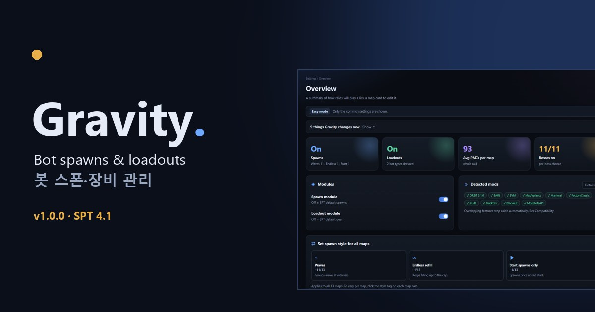

  
  

  

<h2 align="center">📖 <a href="https://danyhappy564-cmyk.github.io/Gravity/?lang=en">Everything is explained on the project site →</a></h2>

Spawns · bosses · loadout tiers · presets · other mods · install and notes, all on one page with screenshots of the web UI.

  
  

## Changelog

The full changelog (12 entries) is in the [`changelog/`](changelog/) folder, 10 per file (higher number = newer, latest: [`CHANGELOG-002.md`](changelog/CHANGELOG-002.md)). Per-release summaries: [Releases](../../releases).

# Gravity 1.0.6

If you like the mod, you can support it here: https://buymeacoffee.com/real_feels

A server + client mod for SPT **4.1**. It decides in one place **who spawns, when, where, and with what gear**. Everything is set from a web page you open in your browser while the game server is running.

## What it does

**Spawn module**

- PMCs: starting squads plus waves or continuous refills, squad-size mix, faction mix, difficulty and level range, stop near the end of the raid.
- Scavs: starting count, active/quiet cycles, map caps (one shared value or per map), protection radius around the player for refills, **intensity over the raid** (early/mid/late multipliers, e.g. the reverse of PMCs: more scavs later).
- Bosses and special bots (sniper scavs, Raiders, Rogues, Cultists, …): chance, count and timing on a timeline; 0 means they never appear. Bosses can have a **chance per map** (empty = the boss's default/shared chance).
- Special bots can be added to maps that don't have them (e.g. Raiders or Rogues on Customs). Extra Raider/Rogue groups get a group count and early/mid/late weights.
- **Trigger spawns**: chance and size for groups released by levers, switches and exfils (Labs and Reserve Raiders) and by game events (Labyrinth Tagilla helpers, Kaban snipers). Raider lever groups can be switched to Rogues or Black Division (the trigger stays the same).
- Faction mods (RUAF, BlackDiv, …) and events (Halloween, Christmas, …): detected, each can be turned on or off.
- Per-map spawn zones, raid-wide group limits, SVM extra raid time detection, raid presets you can save and import.
- Each map shows an estimate of how many PMCs and scavs to expect.

**Loadout module**

- Bots get a tier T1–T7 from their level; each tier picks weapons, armor, plate classes, ammo, meds and attachments.
- **Item tiers**: items are ranked by price (flea, or handbook when missing) within the same slot or type and split into 7 tiers, with the reason shown. Click to override.
- **Tier editor**: per tier, the items and their share, counts and chances, caps and plates, attachments, and a **Tier summary** tab showing what that tier actually carries.
- Attachments follow tiers too. If every part that fits a gun is above the tier, the lowest-tier one is used, so guns never come out bare (can be turned off in Weapon build).
- Mod items: on/off per installed mod, use only part of them each raid, PMC-only.
- **Clothing** (Mod items → Clothing tab): PMCs and scavs wear clothes only from checked mods (matching their side; chosen per mod). Until you save it once, bot outfits are left untouched.
- Loadout presets: **Gravity auto** and **Realistic Live-like 1.0.2** (see Credits) are built in; you can save your own.

## Install

1. Extract the archive into your SPT 4.1 folder. You should get `BepInEx\plugins\Gravity` and `SPT_Runtime\user\mods\Gravity`.
2. Start the server and open `https://127.0.0.1:6969/gravity/` in a browser (also listed on the SPT launcher's mod page).
3. Change settings and press **Save**; they apply from the next raid.

If you open the page from another PC or a Fika/LAN address (anything other than 127.0.0.1 on the server PC), log in with an SPT web admin account using the **SPT login** button at the top before saving — the same SPT login used by SAIN and other mod web pages. Opened on the server PC at 127.0.0.1, no login is needed.

Use **1.0.3 or later within the 1.0.x series** for both server and client. Mixing with 1.0.2 or older is unsupported. Starting scavs are prepared together at the configured delay: 0 min prepares them during loading; the default delay is 4 min. Starting PMC squads prepare their members during loading, with up to 60 seconds of additional waiting. Map capacity, group limits, or unavailable spawn points can leave some bots in the existing queue and delay activation.

**1.0.6:** Raiders, Rogues, Cultists and Bloodhounds can be added to maps that don’t have them (the Special bots page marks "Original / Added by Gravity"). Labs/Reserve lever and exfil groups and Labyrinth/Streets event groups get their own chance and size, and Raider lever groups can be switched to Rogues or Black Division. Extra Raider/Rogue groups: 1–6 groups with early/mid/late weights. Scavs get early/mid/late intensity, so they can ramp up late in the raid (starting scavs excluded, map cap respected). The timeline splits special bots into one collapsible lane per type. With every new field at its default, results match 1.0.5.

**1.0.5:** The web page can save from another PC or a Fika address after an SPT web admin login. The web UI remembers your language (first visit follows the browser). Auto-generated preset names (Custom preset N, etc.) show in the current language. PMC armor-vest/earpiece chances at low tiers and front/back plate chances were raised to SPT's original level (settings still on the old defaults from 1.0.4 or earlier switch automatically). The built-in "Lightweight" raid preset now really lowers map caps, and "Start spawns only" also limits scavs to the raid start.

**1.0.4 preview editing:** PMC and scav controls share **Basic / Details** tabs. Each map shows its own settings and relevant actors; open categories under **All maps (shared)** for global controls. Multi-map editing explains changed and preserved values, and full copies require a difference review before applying.

The **Roll 10 raids** tool uses saved server settings. Entries requiring an event, quest, or interaction are shown separately as **Conditional event candidates**, not counted as actual spawns.

## With other mods

- With **ABPS** (bot placement) installed, Gravity's spawn module locks itself; with **APBS** (bot gear), the loadout module locks. Those features are left to that mod.
- SAIN, ORBIT, SVM, MapVariants (variant maps) and others are detected and handled. See the **Compatibility** page in the web UI.

## Credits

The **Realistic Live-like 1.0.2** preset (named "Realistic and Extended PMC Loadouts" up to 1.0.4) is borrowed with permission from **mip01**’s **APBS Realistic and Extended PMC Loadouts Preset** (Realistic Live-like 1.0.2 from 1.0.4; 7 tiers and 33 tables). Thank you, mip01, for the great preset. Full credits are in [CREDITS.md](CREDITS.md).

## License

MIT — [LICENSE](LICENSE)
