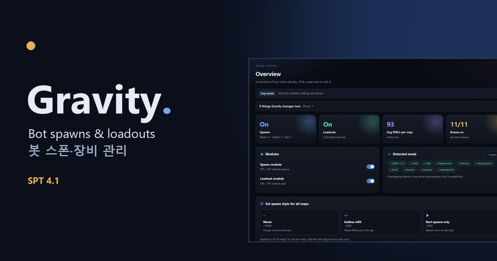

  
  

  

<h2 align="center">📖 <a href="https://danyhappy564-cmyk.github.io/Gravity/">설명은 전부 소개 사이트에 있습니다 →</a></h2>

스폰 · 보스 · 장비 티어 · 프리셋 · 다른 모드와 함께 · 설치와 주의할 점을 웹 화면 사진과 함께 한 페이지에 정리했습니다.

  
  

## 변경 이력

전체 변경 이력 60개는 [`changelog/`](changelog/) 폴더에 10개씩 나눠 있습니다 (번호가 클수록 최신, 최신 파일: [`CHANGELOG-006.md`](changelog/CHANGELOG-006.md)). 릴리즈별 요약은 [Releases](../../releases).

# Gravity 1.1.4

모드가 마음에 드셨다면 후원으로 응원해 주세요: https://buymeacoffee.com/real_feels

SPT **4.1**용 서버·클라이언트 모드입니다. 레이드에 **누가, 언제, 어디서, 무엇을 들고** 나오는지를 한 곳에서 정합니다. 설정은 게임 서버가 켜져 있을 때 브라우저로 여는 웹 화면에서 합니다.

## 무엇을 하나

**스폰 모듈**

- PMC: 레이드 시작 분대 + 웨이브 또는 무한 보충, 분대 크기 비율, 진영 비율, 난이도·레벨 범위(선택: `대원마다 난이도 따로 굴리기`, 기본 꺼짐 — 끄면 분대 전체가 같은 난이도), 레이드 막바지 중단.
- 스캐브: 시작 인원, 활동·휴식 주기, 맵 상한(공통 값 또는 맵마다), 플레이어 근처 보충 보호 거리, **시간대별 강도**(초반·중반·후반 배수 — 예: PMC와 반대로 갈수록 많게).
- 보스·특수 봇(저격 스캐브, 레이더, 로그, 컬티스트 등): 확률·인원·등장 시각(타임라인), 0명이면 안 나옴. 보스는 **맵마다 확률**을 따로 정할 수 있습니다(비우면 보스 기본·공통 확률).
- 특수 봇은 원래 없는 맵(예: 세관의 레이더·로그)에도 넣을 수 있습니다. 레이더·로그 추가 무리는 무리 수와 시간대별 비중을 정합니다.
- **트리거 스폰**: 레버·스위치·탈출구(연구소·리저브 레이더)와 게임 이벤트(미궁 타길라 부하, 카반 저격수)로 나오는 무리의 확률·인원을 정하고, 레이더 레버 무리는 로그·블랙 디비전으로 바꿀 수 있습니다(트리거는 그대로).
- 팩션 모드(RUAF, BlackDiv 등)·이벤트(할로윈·크리스마스 등) 감지와 켜고 끄기.
- 맵별 스폰 구역 켜고 끄기, 레이드 전체 그룹 제한, SVM 추가 레이드 시간 감지, 레이드 프리셋 저장·가져오기.
- 화면에서 맵마다 예상 PMC·스캐브 수를 미리 보여 줍니다.

**장비 모듈**

- 봇 레벨에 따라 T1~T7 티어를 정하고, 티어마다 무기·방어구·방탄판 등급·탄약·의약품·부착물을 고릅니다.
- **아이템 티어**: 같은 칸·같은 종류 안에서 가격(플리, 없으면 핸드북) 순위를 7등분해 자동 티어를 매기고, 왜 그 티어인지 보여 줍니다. 눌러서 직접 바꿀 수 있습니다.
- **봇별 아이템 표**(장비 티어 › 봇별 아이템 표 탭): 티어마다 나올 아이템과 비율, 개수·확률, 상한·방탄판, 부착물, 그리고 **티어 요약** 탭(그 티어가 실제로 무엇을 들고 나오는지)을 봅니다.
- 부착물도 티어를 따릅니다. 그 총에 맞는 부착물이 전부 티어 위면 가장 낮은 티어 것을 달아 '맨 총'이 나오지 않습니다(무기 구성에서 끌 수 있음).
- 모드 아이템: 설치된 모드별로 켜고 끄기, 레이드마다 일부만 쓰기, PMC만 쓰기.
- **의상**(모드 아이템 → 의상 탭): 체크한 모드의 옷만 PMC·스캐브가 입습니다(진영에 맞는 옷만, 모드 단위로 고름). 한 번도 저장하지 않았다면 봇 옷을 바꾸지 않습니다.
- 장비 프리셋: **Gravity 자동**과 **Realistic Live-like 1.0.2**(아래 감사 참고) 두 가지가 들어 있고, 내 프리셋을 저장할 수 있습니다.

## 설치

1. SPT 4.1이 설치된 폴더에 압축을 그대로 풉니다. `BepInEx\plugins\Gravity`와 `SPT_Runtime\user\mods\Gravity`가 생기면 맞습니다.
2. 서버를 켜고 브라우저에서 `https://127.0.0.1:6969/gravity/`를 엽니다(SPT 런처의 모드 목록에서도 열 수 있습니다).
3. 설정을 바꾸고 **저장**을 누르면 다음 레이드부터 적용됩니다.

다른 PC나 Fika·내부망 주소(서버 PC의 127.0.0.1이 아닌 주소)로 웹을 열었다면, 저장하기 전에 화면 위 **SPT 로그인** 버튼으로 SPT 웹 관리자 계정에 로그인하십시오(SAIN 등 다른 모드 웹 화면과 같은 SPT 로그인입니다). 서버 PC에서 127.0.0.1로 열면 로그인이 필요 없습니다.

서버와 클라이언트는 모두 **1.0.3 이상인 같은 1.0.x 버전**으로 맞추십시오. 1.0.2 이하와 혼용할 수 없습니다. 시작 스캐브는 설정한 지연 시각에 함께 준비합니다. 지연 0분이면 로딩 중에 준비하며, 기본 지연은 4분입니다. 시작 PMC 분대는 로딩 중에 대원까지 준비하며, 추가 대기는 최대 60초입니다. 맵 상한·그룹 제한·지점 부족으로 준비하지 못한 인원은 기존 대기열로 진행하므로 생성이 늦어질 수 있습니다.

**1.1.4:** 웹 설정을 쉽게 바꿨습니다. 처음 열면 **빠른 설정**(봇 인원·레이드 흐름·난이도·장비 수준·보스 빈도·성능을 단계 버튼으로), 사이드바 맨 위 **설정 찾기**(`/` 또는 Ctrl+K, 고급 칸이면 고급 모드로 바꿔 그 칸으로 이동), 메뉴 22개 → 16개(장비 티어·프리셋 · 백업·호환 · 진단·게임 안 동작은 탭으로 합침, 옛 주소는 새 자리로). 맵 탭에서 공통 값을 따르는 칸을 바꾸면 "이 맵만 / 모든 맵"을 고르는 막대가 뜹니다. 아이템 티어 탄약을 **관통력 구간**으로 거를 수 있습니다. **봇 종류별 체력 배율**(봇 체력 · 스킬 페이지, 티어 체력 뒤에 곱함)과 맵별 **이 맵 스캐브는 바닐라에 맡기기**(세관 주유소처럼 퀘스트 구역에 스캐브가 잘 안 나올 때)를 넣었습니다. PMC 분대 대원마다 난이도를 따로 굴리는 선택 칸(기본 꺼짐)이 들어갔습니다. FAQ 6개 추가, FAQ 답 안 설정 이름을 누르면 그 칸으로 갑니다.

**1.1.2:** Fika 헤드리스 서버에서 "근처 보충"이 한 번도 돌지 않던 것을 고쳤습니다. 이제 접속한 사람 플레이어를 차례로 돌아가며 기준으로 삼습니다. 혼자 하는 게임은 지금까지와 같습니다. 또 서버에서 PMC 생성이 재시작 전까지 통째로 실패할 수 있던 문제를 고쳤습니다(시작 PMC가 0명으로 끝나고 서버 기록에 `capacity` 오류가 쌓이던 것). 봇마다 소모품 목록을 따로 복사해 걸러서, 뒤에 나오는 고티어 PMC가 앞 봇 기준으로 깎인 약품 목록을 받던 것도 함께 없어졌습니다. 같은 진영 PMC 분대 둘이 같은 구역에 거의 동시에 나오면 게임이 한 무리로 합쳐 5~6명 분대가 되던 것도 고쳐, 이제 웨이브 하나가 무리 하나입니다(분대 인원 설정·동시 그룹 제한이 실제와 맞음). 무기 구성 → 탄창 · 탄약에 낱개 탄약 "한 칸 크기 기준"(EFT 기본 / 게임 값)과 "묶음 크기" % 범위를 넣었습니다. 기본은 EFT 원래 한 칸 크기라, SVM 같은 모드로 탄 묶음을 키워도 주머니에 수백 발이 들어가지 않습니다. 서버·클라 둘 다 바뀌었고 설정은 그대로 이어집니다.

**1.1.1:** 봇이 갇히는 자리나 사람 바로 앞에 나오던 것을 줄였습니다. 레이드를 시작할 때 맵의 실제 봇 이동 경로로 스폰 지점을 한 번 검사합니다. 가까이에 길이 없거나, 순찰 경로와 끊겼거나, 웅크려야 하는 낮은 통로로만 나갈 수 있는 지점에는 봇을 올리지 않습니다. 공장 가운데 탱크 옆 구덩이(봇이 웅크린 채 못 나오던 곳)는 따로 막았습니다. 스캐브(일반·저격 스캐브 포함)는 나올 때 모든 사람에게서 스캐브 거리 이상 떨어지고 보이지 않는 지점을 먼저 고릅니다. 그런 지점이 없으면 거리 절반까지 허용합니다(이때도 안 보이는 지점). 그것도 없으면 스캐브 거리 이상 떨어진 지점을 보이더라도 쓰고, 그런 지점도 없으면 잠시 미뤘다가 다시 고릅니다. 서버가 시간에 맞춰 내보내는 스캐브 무리에도 같은 검사가 적용됩니다. 1.1.x끼리는 서버·클라이언트를 섞어 써도 됩니다.

**1.1.0:** 고티어 봇 총에 조준경이 빠지던 것을 고쳤습니다(조준경을 받는 마운트 칸은 조준경 확률 이상으로 굴림, SPT 봇 표에 부품 표가 없는 부품은 그 부품을 가진 다른 봇 표로 메움). 서버 측정에서 PMC 조준경 장착률이 80% 안팎에서 91~94%로 올랐습니다. **낱개 탄약**이 기본으로 켜집니다(봇마다 40%, 최대 2묶음). 새로 설치하면 웹 화면 기본값을 그대로 씁니다. 웹 화면에 있었지만 게임에 적용되지 않던 설정(대용량 탄창 제한·조준경/전술 장치 개수·밤 손전등·맵별 무기 성향·상탄·보스 점증·근처 보충 간격·보충 상한·시작 분대 규칙 등)을 모두 실제로 적용했고, 근처 보충 **시야 안에도 스폰 허용**이 거꾸로 동작하던 것을 고쳤습니다. 새로 적용된 칸 가운데 옛 설정 파일에서 결과가 달라지는 것은 지금까지와 같은 값으로 읽습니다(낱개 탄약과 시야 수정은 예외로 바로 적용). **BTR 빈도**(삼림·스트리트만), 무기·장비·부품·기타 탭별 모드 아이템 끄기, 게임 화면 표시·지금 넣어 보기(개발 · 확인)가 들어갔습니다. **Fika 호스트**(기여: darkarchon)와 **세관 클래식**(MapVariants 1.1.0 이상)과 함께 쓸 수 있습니다.

**1.0.9:** PMC를 "시작만"으로 두면 스캐브 레이드에 PMC가 0명이던 것을 고쳤습니다. 스캐브 레이드 때 PMC 남기는 방식에 **남은 시간**(남은 레이드 시간 비율만큼 남김)을 넣었습니다. **모드 아이템 사용** 스위치가 생겼습니다: 새로 설치하면 꺼짐, 이미 쓰던 설정은 켜짐 그대로입니다. 모드 무기·장비를 켜면 이상한 조합이 나올 수 있으니 티어 편집기에서 정리해 주십시오. 봇 표에 없던 바닐라 총은 그 총을 가진 봇 표(USEC·BEAR 먼저)의 부품 목록을 빌려 써 조합이 자연스러워졌고, 봇 장비 기록에 조준경 여부·부품 수가 나옵니다.

**1.0.8:** 스캐브 카드에 **스캐브 몰림**(웨이브 몰림 = 보충 빈도, 인원 몰림 = 살아 있는 스캐브 상한)을, 스폰 위치 카드에 **웨이브 PMC 위치**(PMC 지점 / 맵 전체: 웨이브 PMC만 스캐브 구역까지 고르게, 저격 자리 제외)를, 상한 카드에 **레이드 전체 봇 총량**(누적 수, 닿으면 Gravity 스폰만 멈춤)을 넣었습니다. 게임이 몸을 읽는 중인 분대의 지점을 다른 분대가 고르던 겹침을 막고, 분대장보다 30초 넘게 늦게 나온 PMC 대원은 분대장이 죽었거나 사람 바로 옆이면 내지 않습니다. 레이드 보고서에 **분대 진단**(겹침·늦은 대원·시작 PMC 계획/활성화)이 생겼고, 레이드 끝 로그에 시작 PMC 결과 한 줄이 남습니다. 새 칸은 기본값이면 1.0.7과 같은 결과입니다.

**1.0.7:** 타임라인에서 특수 봇 줄(저격 스캐브·컬티스트·블러드하운드 등)을 펼치면 설정 창을 열 곳이 없어 확률을 바꿀 수 없던 문제를 고쳤습니다(1.0.6부터). 이제 펼친 줄의 오른쪽 요약 글자나 시각 버블을 누르면 설정 창이 열리고, 버블을 끌면 예전처럼 시각만 옮겨집니다. 서버·웹만 바뀌었고 스폰 결과는 1.0.6과 같습니다.

**1.0.6:** 레이더·로그·컬티스트·블러드하운드를 원래 없는 맵에도 넣을 수 있습니다(특수 봇 페이지에 "원래 있음 / Gravity가 새로 넣음" 표시). 연구소·리저브 레버·탈출구 무리와 미궁·스트리트 이벤트 무리의 확률·인원을 정하고, 레이더 레버 무리는 로그·블랙 디비전으로 바꿀 수 있습니다. 레이더·로그 추가 무리는 1~6개, 시간대별 비중을 정합니다. 스캐브는 초반·중반·후반 강도를 정해 PMC와 반대로 후반에 많게 할 수 있습니다(시작 스캐브 제외, 맵 상한 안). 레버 무리는 작동 뒤 지연과 "바꾼 무리로 나올 비율"(예: 판마다 30%만 로그)도 정합니다. 추가 무리·RUAF 순찰은 "초반 몰림 / 고르게 / 후반 몰림" 버튼으로 한 번에 정하고, 스캐브 강도는 맵 탭에서 맵마다 따로 둘 수 있습니다. 미리보기 위 "맵 동시 상한" 칸은 설정이 상한·종류별 최대·그룹 제한에 걸릴 것 같으면 노란 팁과 고치기 버튼을 보여 주고, "상한 자동 맞춤"을 켜면 상한이 설정에 맞춰 늘거나 줄어듭니다(맵 탭 아래쪽의 같은 칸은 정리). 타임라인은 특수 봇을 종류마다 줄로 나눠 접고 펼치며, 폰에서는 옆으로 밀어 보고 누르기 쉽게 했습니다. 스캐브 방식에 "웨이브 목록 (PMC처럼)"이 생겨, 스캐브 웨이브를 타임라인 버블로 보고 끌어서 시각을 바꾸거나 눌러서 인원을 고칠 수 있습니다(생성기로 한 번에 채우기, 다른 맵에 복사, 타임라인 1·2·4배 확대). 기존 "활동·휴식 채우기" 방식은 그대로 있습니다. 봇별 장비 티어에 "티어 분포"(예: T2 30% · T3 50% · T4 20%)가 생겼고, 주간 보스 스위치가 실제로 적용되도록 고쳤습니다(끄면 맵 선택 화면 해골 표시도 꺼짐). 새 "봇 체력 · 스킬" 페이지에서 봇 티어(T1~T7)마다 체력(원래대로 / PMC 기준 440 / 배율)과 일반 스킬(원래대로 / 레벨 고정 / 원래의 %)을 정하고, 따를 봇 묶음(스캐브·PMC·특수 봇·보스·호위)을 고릅니다("모든 티어: 체력 440 · 스킬 레벨 1" 버튼, 무기 숙련·내 스캐브는 그대로). 주소 끝에 `#demo`를 붙이면 서버 없이 예시 화면을 볼 수 있습니다. 새 칸이 모두 기본값이면 1.0.5와 결과가 같습니다. "시작 PMC는 플레이어 시작 지점만"을 켜면 시작 PMC가 거의 안 나오던 문제(1.0.1부터)도 고쳤습니다. 그 지점이 막히면 같은 구역의 PMC 지점에 냅니다.

**1.0.5:** 다른 PC·Fika 주소로 연 웹도 SPT 웹 관리자로 로그인하면 저장됩니다. 웹 언어 선택이 저장됩니다(처음 열면 브라우저 언어). 자동으로 붙은 프리셋 이름(커스텀 프리셋 N 등)은 지금 언어로 보입니다. PMC의 방탄복·헤드셋 낮은 티어 확률과 앞뒤 방탄판 확률을 SPT 원본 수준으로 올렸습니다(1.0.4 이하에서 기본값 그대로 쓰던 설정은 자동으로 새 값). 기본 레이드 프리셋 "가볍게"의 맵 상한 줄이기가 실제로 적용되고, "시작 스폰만"은 스캐브도 시작 때만 나옵니다.

**1.0.4 미리보기 편집:** PMC·스캐브는 **기본 수정 / 자세한 수정**으로 나뉩니다. 맵 화면에는 해당 맵의 설정·등장 대상만 표시하며, 공통 설정은 **모든 맵(공통)**에서 분류를 눌러 엽니다. 여러 맵 동시 편집은 변경·유지 범위를 안내하고, 전체 복사는 차이를 검토한 뒤 적용합니다.

개발·확인의 **10번 굴리기**는 서버에 저장된 설정으로 계산합니다. 이벤트·퀘스트·상호작용 조건이 필요한 항목은 **조건부 이벤트 후보**로 따로 표시하며, 실제 등장 결과로 세지 않습니다.

## 다른 모드와 함께 쓸 때

- **ABPS**(봇 배치 모드)가 있으면 Gravity 스폰 모듈이, **APBS**(봇 장비 모드)가 있으면 Gravity 장비 모듈이 스스로 잠깁니다. 두 모드를 함께 쓰는 경우 해당 기능은 그 모드에 맡깁니다.
- **ISB Special Forces**는 막지도 관리하지도 않습니다(ISB 설정 그대로). 봇 상한·연구소 이벤트·블랙 디비전이 겹치는 곳은 웹의 **호환 · 진단** 페이지와 [자주 묻는 질문](https://danyhappy564-cmyk.github.io/Gravity/#faq-isb)에 정리했습니다.
- **WTT PackNStrap**(1.0.7~)이 있으면 봇 완장 칸에 티어별 벨트를 채우고 탄창을 벨트에 먼저 넣습니다(기본 PMC만, 봇 벨트는 못 줍게). 웹 **모드 아이템 → PackNStrap 벨트**에서 바꿉니다. [자주 묻는 질문](https://danyhappy564-cmyk.github.io/Gravity/#faq-pns)
- **PBT(Harmony_Profiles)는 공식 호환하지 않습니다. 함께 쓰지 마십시오.** PBT가 PMC 장비를 자기가 저장한 장비로 바꿔 입히므로, 그 상태에서 생긴 장비 문제(탄창 없는 봇 등)는 Gravity에서 지원하지 않습니다.
- SAIN·ORBIT·SVM·MapVariants(변형 맵) 등은 감지해서 맞춰 동작합니다. 감지 결과는 웹의 **호환 · 진단** 페이지에서 볼 수 있습니다.

## 감사

장비 프리셋 **Realistic Live-like 1.0.2**(1.0.4까지 이름 "Realistic and Extended PMC Loadouts")는 **mip01**님이 제작한 **APBS Realistic and Extended PMC Loadouts Preset**을 허락을 받아 차용했습니다(1.0.4부터 Realistic Live-like 1.0.2 기준, 7티어·33개 표). 좋은 프리셋을 만들어 주신 mip01님께 감사드립니다. 자세한 출처는 [CREDITS.md](CREDITS.md)에 있습니다.

## 라이선스

MIT — [LICENSE](LICENSE)
