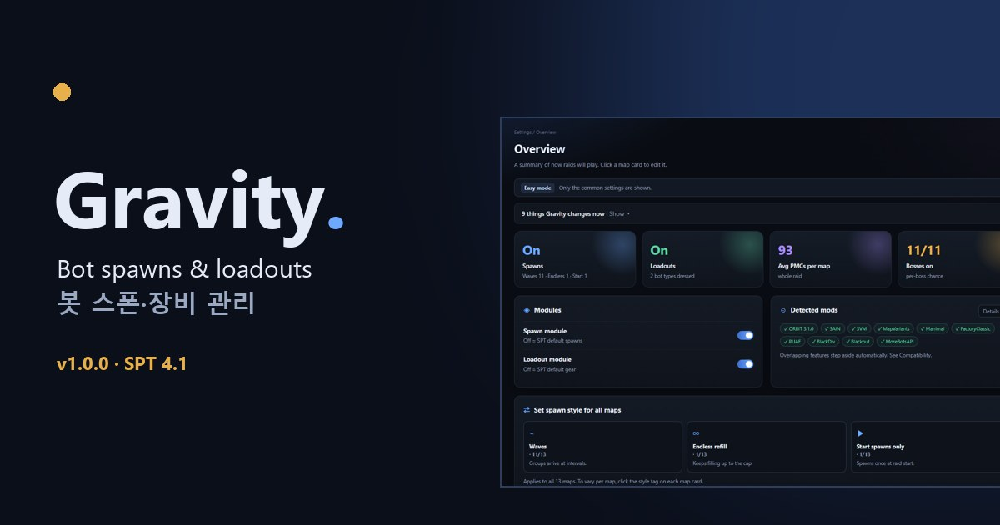

  
  

  

<h2 align="center">📖 <a href="https://danyhappy564-cmyk.github.io/Gravity/">설명은 전부 소개 사이트에 있습니다 →</a></h2>

스폰 · 보스 · 장비 티어 · 프리셋 · 다른 모드와 함께 · 설치와 주의할 점을 웹 화면 사진과 함께 한 페이지에 정리했습니다.

  
  

## 변경 이력

전체 변경 이력 8개는 [`changelog/`](changelog/) 폴더에 10개씩 나눠 있습니다 (번호가 클수록 최신, 최신 파일: [`CHANGELOG-001.md`](changelog/CHANGELOG-001.md)). 릴리즈별 요약은 [Releases](../../releases).

# Gravity 1.0.3

모드가 마음에 드셨다면 후원으로 응원해 주세요: https://buymeacoffee.com/real_feels

SPT **4.1**용 서버·클라이언트 모드입니다. 레이드에 **누가, 언제, 어디서, 무엇을 들고** 나오는지를 한 곳에서 정합니다. 설정은 게임 서버가 켜져 있을 때 브라우저로 여는 웹 화면에서 합니다.

## 무엇을 하나

**스폰 모듈**

- PMC: 레이드 시작 분대 + 웨이브 또는 무한 보충, 분대 크기 비율, 진영 비율, 난이도·레벨 범위, 레이드 막바지 중단.
- 스캐브: 시작 인원, 활동·휴식 주기, 맵 상한(공통 값 또는 맵마다), 플레이어 근처 보충 보호 거리.
- 보스·특수 봇(저격 스캐브, 레이더, 로그, 컬티스트 등): 확률·인원·등장 시각(타임라인), 0명이면 안 나옴.
- 팩션 모드(RUAF, BlackDiv 등)·이벤트(할로윈·크리스마스 등) 감지와 켜고 끄기.
- 맵별 스폰 구역 켜고 끄기, 레이드 전체 그룹 제한, SVM 추가 레이드 시간 감지, 레이드 프리셋 저장·가져오기.
- 화면에서 맵마다 예상 PMC·스캐브 수를 미리 보여 줍니다.

**장비 모듈**

- 봇 레벨에 따라 T1~T7 티어를 정하고, 티어마다 무기·방어구·방탄판 등급·탄약·의약품·부착물을 고릅니다.
- **아이템 티어**: 같은 칸·같은 종류 안에서 가격(플리, 없으면 핸드북) 순위를 7등분해 자동 티어를 매기고, 왜 그 티어인지 보여 줍니다. 눌러서 직접 바꿀 수 있습니다.
- **티어 편집기**: 티어마다 나올 아이템과 비율, 개수·확률, 상한·방탄판, 부착물, 그리고 **티어 요약** 탭(그 티어가 실제로 무엇을 들고 나오는지)을 봅니다.
- 부착물도 티어를 따릅니다. 그 총에 맞는 부착물이 전부 티어 위면 가장 낮은 티어 것을 달아 '맨 총'이 나오지 않습니다(무기 구성에서 끌 수 있음).
- 모드 아이템: 설치된 모드별로 켜고 끄기, 레이드마다 일부만 쓰기, PMC만 쓰기.
- 장비 프리셋: **Gravity 자동**과 **Realistic and Extended PMC Loadouts**(아래 감사 참고) 두 가지가 들어 있고, 내 프리셋을 저장할 수 있습니다.

## 설치

1. SPT 4.1이 설치된 폴더에 압축을 그대로 풉니다. `BepInEx\plugins\Gravity`와 `SPT_Runtime\user\mods\Gravity`가 생기면 맞습니다.
2. 서버를 켜고 브라우저에서 `https://127.0.0.1:6969/gravity/`를 엽니다(SPT 런처의 모드 목록에서도 열 수 있습니다).
3. 설정을 바꾸고 **저장**을 누르면 다음 레이드부터 적용됩니다.

서버와 클라이언트는 모두 **1.0.3 이상인 같은 1.0.x 버전**으로 맞추십시오. 1.0.2 이하와 혼용할 수 없습니다. 시작 스캐브는 설정한 지연 시각에 함께 준비합니다. 지연 0분이면 로딩 중에 준비하며, 기본 지연은 4분입니다. 시작 PMC 분대는 로딩 중에 대원까지 준비하며, 추가 대기는 최대 60초입니다. 맵 상한·그룹 제한·지점 부족으로 준비하지 못한 인원은 기존 대기열로 진행하므로 생성이 늦어질 수 있습니다.

**2026-11-12 교체된 1.0.3**에는 미리보기 수정이 포함됩니다. 먼저 받은 1.0.3은 다시 내려받아 업데이트하십시오.

개발·확인의 **10번 굴리기**는 서버에 저장된 설정으로 계산합니다. 이벤트·퀘스트·상호작용 조건이 필요한 항목은 **조건부 이벤트 후보**로 따로 표시하며, 실제 등장 결과로 세지 않습니다.

## 다른 모드와 함께 쓸 때

- **ABPS**(봇 배치 모드)가 있으면 Gravity 스폰 모듈이, **APBS**(봇 장비 모드)가 있으면 Gravity 장비 모듈이 스스로 잠깁니다. 두 모드를 함께 쓰는 경우 해당 기능은 그 모드에 맡깁니다.
- SAIN·ORBIT·SVM·MapVariants(변형 맵) 등은 감지해서 맞춰 동작합니다. 감지 결과는 웹의 **호환 · 진단** 페이지에서 볼 수 있습니다.

## 감사

장비 프리셋 **Realistic and Extended PMC Loadouts**는 **mip01**님의 *APBS Realistic and Extended PMC Loadouts Preset*을 값 그대로 옮긴 것입니다(모드 아이템 제외, Gravity에 없는 기능 몇 가지는 가장 가까운 값). mip01님이 원작 APBS 프리셋 제작자의 허락을 받아 만든 에드온이며, 바탕은 **acidphantasm**님의 APBS입니다. 자세한 내용은 [CREDITS.md](CREDITS.md)에 있습니다.

## 라이선스

MIT — [LICENSE](LICENSE)
